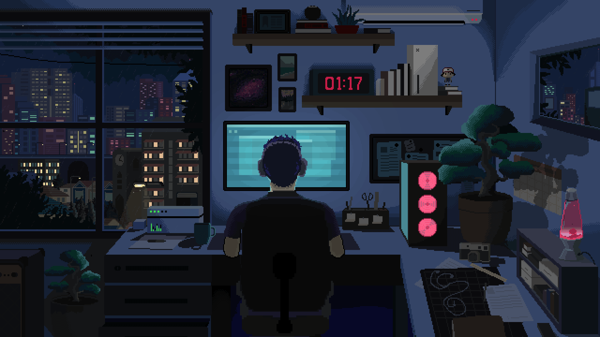

  

<h1 align="center">Hi 👋, I'm Ahmad Imtiyaz Najih</h1>

<h3 align="center">Backend-leaning Full Stack Developer</h3>

  

  Building scalable backend systems and shipping faster with AI-assisted coding.

---

<h2 align="center">🚀 About Me</h2>

**Imtiyaz**, here — a 7th-semester student at **Universitas Veteran Semarang**, focused on backend development.

I enjoy building scalable, maintainable systems with **Laravel & PHP**, and I care about clean architecture and clean code.

Currently, I'm expanding into **mobile development with Flutter**, while experimenting with **vibe coding** — using AI coding agents to speed up my workflow.

My goal is simple: write clean code, ship reliable software, and keep growing into an engineer who builds things that last.

 

---

<h2 align="center">🤝 Connect</h2>

  &nbsp;
  &nbsp;
  

---

<h2 align="center">💻 Tech Stack</h2>

  
   
  

---

<h2 align="center">📊 GitHub Stats</h2>

  

---

<h2 align="center">📈 Activity Graph</h2>

  

  

