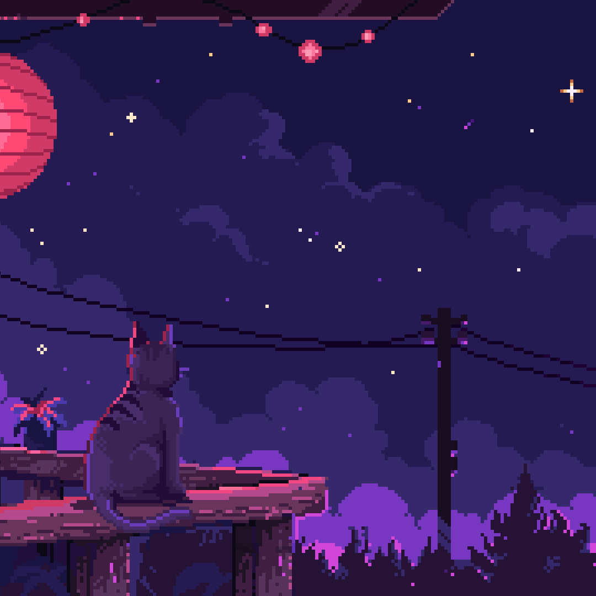

  

<h1 align="center">Hi 👋, I'm Ahmad Imtiyaz Najih</h1>

<h3 align="center">Mobile · Web · Full Stack Developer — and a proud Vibe Coder</h3>

  

  Building mobile apps and web products end to end, and shipping faster with AI coding agents.

---

<h2 align="center">🚀 About Me</h2>

**Yazna**, here — a 7th-semester student at **Universitas Veteran Semarang** who doesn't stick to just one side of the stack.

📱 **Mobile:** building Android apps with **Flutter** 
🌐 **Frontend:** crafting web interfaces with **React** 
🛠️ **Backend / Full Stack:** building solid systems with **Laravel**

These days I'm a **vibe coder** — most of my work happens alongside AI coding agents like **Claude Code**, **Pi Agent**, and **OpenCode**, so I can spend less time on boilerplate and more time shipping.

My goal is simple: turn ideas into working products, fast, and keep growing along the way.

 

---

<h2 align="center">🤝 Connect</h2>

  &nbsp;
  &nbsp;
  

---

<h2 align="center">💻 Tech Stack</h2>

  
   
  

  <b>🤖 Vibe Coding Toolkit</b>  
  
  
  

---

<h2 align="center">📊 GitHub Stats</h2>

  

---

<h2 align="center">📈 Activity Graph</h2>

  

  

